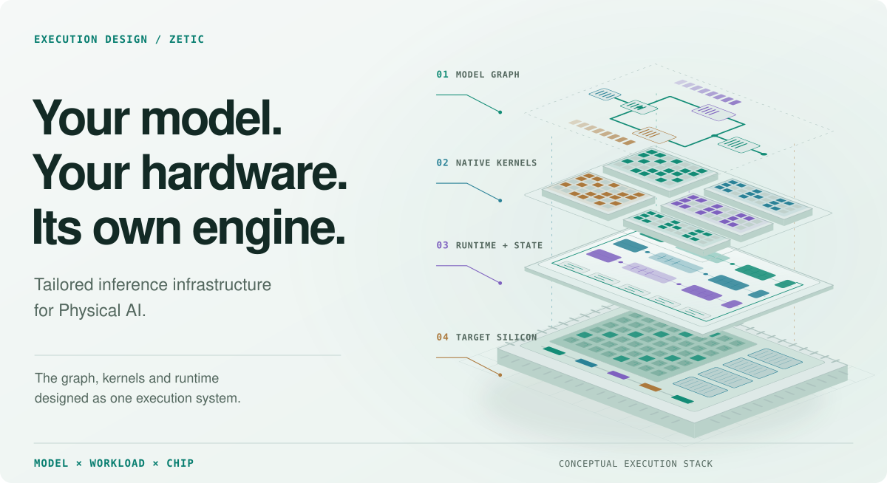
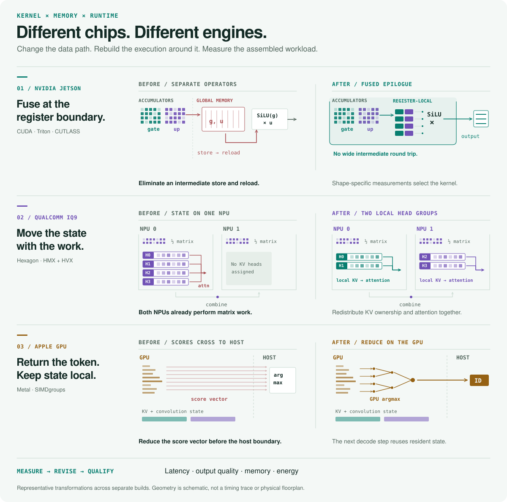

<picture>
  <source media="(prefers-color-scheme: dark)" srcset="https://raw.githubusercontent.com/zetic-ai/.github/main/profile/assets/zetic-white.png">
  <source media="(prefers-color-scheme: light)" srcset="https://raw.githubusercontent.com/zetic-ai/.github/main/profile/assets/zetic-black.png">
  
</picture>

  

<picture>
  <source media="(max-width: 600px) and (prefers-color-scheme: dark)" srcset="https://raw.githubusercontent.com/zetic-ai/.github/main/profile/assets/hero-mobile-dark.svg">
  <source media="(max-width: 600px) and (prefers-color-scheme: light)" srcset="https://raw.githubusercontent.com/zetic-ai/.github/main/profile/assets/hero-mobile-light.svg">
  <source media="(prefers-color-scheme: dark)" srcset="https://raw.githubusercontent.com/zetic-ai/.github/main/profile/assets/hero-dark.svg">
  <source media="(prefers-color-scheme: light)" srcset="https://raw.githubusercontent.com/zetic-ai/.github/main/profile/assets/hero-light.svg">
  
</picture>

# Tailored inference infrastructure for Physical AI.

ZETIC builds inference engines around **your model, your workload and your hardware**. We co-design the model graph, numerical precision, native kernels, memory layout and runtime so robot intelligence can run faster on the machine that needs it.

Our work spans **VLA policies, vision-language models, perception and language models**, with execution paths built for NVIDIA Jetson, Qualcomm Hexagon and Apple GPUs.

**[Explore Ixian Bench ↗](https://ixian.zetic.ai/) · [Watch robot demos ↗](https://zetic.ai/demos/) · [Website ↗](https://zetic.ai/) · [Talk to us ↗](mailto:contact@zetic.ai)**

## The benchmark changes the build.

**Measure the complete workload.** Find where the model waits: kernel launches, weight reads, intermediate tensors, state transfers or work that the application never consumes.

**Redesign the execution.** Write or specialize kernels, change tensor layouts and precision boundaries, then build the runtime plan that connects them. Reuse the implementations that fit the next model and target.

**Let output quality decide what ships.** Compare latency alongside numerical behavior and task outcomes. A faster kernel earns its place by improving the assembled workload within its acceptance criteria.

<picture>
  <source media="(max-width: 600px) and (prefers-color-scheme: dark)" srcset="https://raw.githubusercontent.com/zetic-ai/.github/main/profile/assets/method-mobile-dark.svg">
  <source media="(max-width: 600px) and (prefers-color-scheme: light)" srcset="https://raw.githubusercontent.com/zetic-ai/.github/main/profile/assets/method-mobile-light.svg">
  <source media="(prefers-color-scheme: dark)" srcset="https://raw.githubusercontent.com/zetic-ai/.github/main/profile/assets/method-dark.svg">
  <source media="(prefers-color-scheme: light)" srcset="https://raw.githubusercontent.com/zetic-ai/.github/main/profile/assets/method-light.svg">
  
</picture>

## Measured on the hardware.

| Model × target | Starting point | Tailored build | Measurement |
| :--- | ---: | ---: | :--- |
| [**RLDX-1 · Jetson AGX Thor**](https://ixian.zetic.ai/models/rldx1) | 156.52 ms torch.compile BF16 | **59.405 ms** Mixed precision | Action-chunk latency · p50 |
| [**SmolVLA · Jetson AGX Orin**](https://ixian.zetic.ai/models/smolvla) | 94.15 ms torch.compile BF16 | **35.39 ms** Mixed precision | Action-chunk latency · p50 |
| [**LFM3-1.7B · Dragonwing IQ9**](https://lfm3.zetic.ai/#iq9-engineering) | 17.7 tok/s Native A | **26.6 tok/s** Native B | 64K-context decode |

Measurement conditions and output-quality evidence

Jetson rows compare BF16 `torch.compile` with ZETIC mixed precision at batch one. RLDX uses four timing rounds per build; SmolVLA uses two reference rounds and one ZETIC round, with remeasurement pending in the public record. IQ9 compares two native builds: moving attention and KV ownership together lets both NPUs perform attention. Each linked record supplies its own test conditions and output-quality evidence.

 

**[Compare more models, boards and execution paths on Ixian Bench →](https://ixian.zetic.ai/)**

## Inside the stack.

| Work | What it makes possible | Explore |
| :--- | :--- | :--- |
| **Ixian** | Model-specific compilation and native execution for robotics workloads. Graph rewrites, transformed weights and specialized kernels become an executable runtime plan. | [Measured builds](https://ixian.zetic.ai/) |
| **Ixian Bench** | Inspect latency, memory, energy and quality records across models, hardware and execution paths. | [Benchmark explorer](https://ixian.zetic.ai/models/compare) |
| **Native LFM3 execution** | Target-specific kernels, persistent state and memory movement across Hexagon and Apple GPU implementations. | [Implementation report](https://lfm3.zetic.ai/) |
| **Robot workload R&D** | Extend execution design into multi-model orchestration and decision-model selection, including RoboRouter research. | [Robot demonstrations](https://zetic.ai/demos/) |

## Build with ZETIC.

Bring the **model, target board and workload**. We work through the execution constraints, define performance and output-quality requirements, and build an inference path for your system.

**[contact@zetic.ai](mailto:contact@zetic.ai)** · [LinkedIn](https://www.linkedin.com/company/zetic-ai/)

<b>Also building for mobile: Melange</b>

Melange is our on-device inference product for iOS and Android apps, with device benchmarking and SDK integration.

[Explore Melange](https://zetic.ai/melange/) · [Documentation](https://docs.zetic.ai/) · [Example applications](https://github.com/zetic-ai/ZETIC_MLange_apps)

